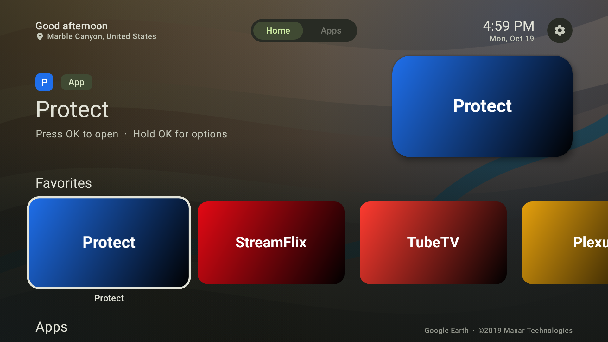
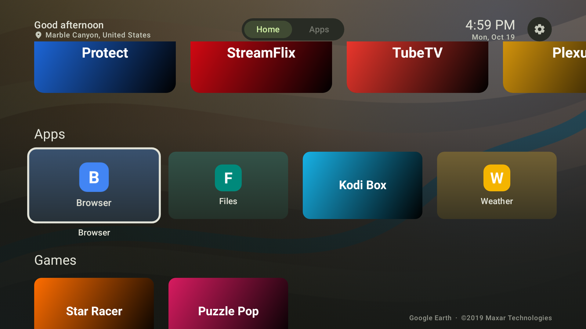
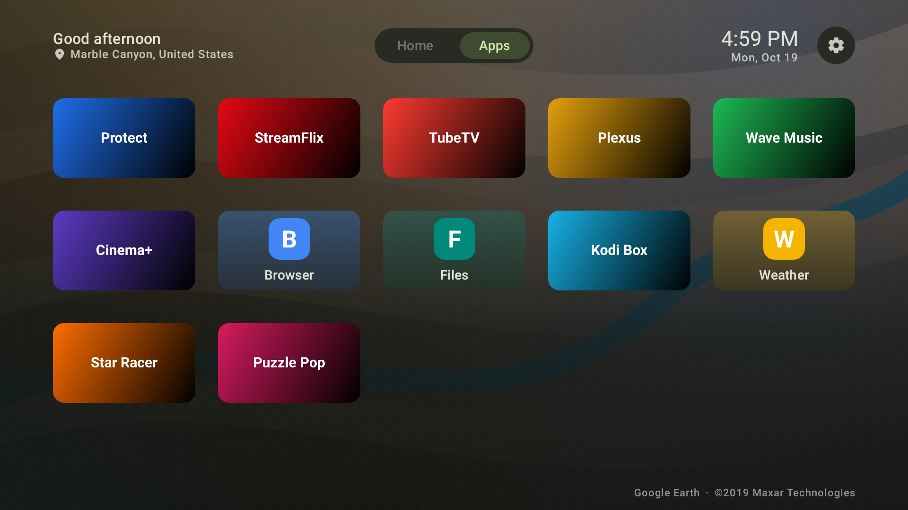
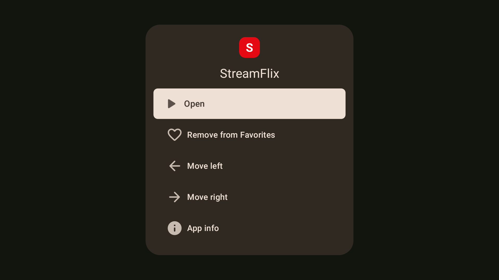

# Shield Home

A custom home-screen launcher for the NVIDIA Shield TV (and other Android TV / Google TV
devices) with a **Material Design 3** look and a Google TV-style layout.



| Browsing lower rows | All apps | Long-press menu |
| --- | --- | --- |
|  |  |  |

_Screenshots are rendered headlessly with placeholder apps and a painted stand-in backdrop; on a device the tiles show each app's real banner and the background is an Earth View photo._

## Design

Built on **Material Design 3** via Compose for TV (`androidx.tv:tv-material`):

- **Colour:** a full M3 dark tonal scheme generated with material-color-utilities
  (`SchemeTonalSpot`) from the seed `#76B900`, including the surface-container roles.
  The background picks up a faint wash of the focused app's colour (content-based colour).
- **Type & shape:** the M3 type scale (display, headline, title, body, label roles) and the
  M3 shape scale (extra-small 4dp to extra-large 28dp).
- **Components:** TV Material 3 `TabRow` with the pill indicator, `Card`s with the scheme's
  focus ring and focus scale, `IconButton`, a tonal label in the hero, and an M3 dialog
  (extra-large shape, icon + headline) built from `ListItem`s.

**Backdrop:** the background is a photo from **Google Earth View**, Google's stock "Earth"
wallpaper collection (the same set used by Chrome, Chromecast and Pixel). A new photo is
loaded each time you return to Home (at most every 2 minutes) and every 15 minutes while
Home stays open; it sits under an M3 scrim so text stays readable. The place name appears
under the greeting and the imagery credit in the bottom-right corner. Only photo IDs ship
with the app (`res/raw/earthview_ids.txt`); images are downloaded from Google's static feed
when needed, and the most recent one is cached so Home never starts blank. With no network
the background falls back to the plain M3 surface.

The layout still follows Google TV: greeting and tabs across the top (tabs switch when they
receive focus), a featured area for the focused app that collapses as you browse further
down, and horizontal rows of 16:9 tiles.

## Features

- Lists every launchable app (TV-native apps use their banner; phone apps get a generated tile
  from their icon and dominant colour).
- **Favorites** row, seeded on first run (UniFi Protect, YouTube, Netflix, Plex, Disney+, …
  if installed). Hold **OK** on any tile to add/remove favourites, reorder them, or open App info.
- **Apps** tab with a full grid of everything installed; **Games** detected via the app category.
- Live clock/date, Settings shortcut, and automatic refresh when apps are installed, updated or removed.
- Back never exits the launcher; it returns to the Home tab.
- Rotating Google Earth View photo backdrop with location and credit.

## Build & install

Requires JDK 17+ and the Android SDK (platform 35).

```bash
./gradlew assembleRelease          # app/build/outputs/apk/release/app-release.apk (debug-signed)
adb connect <shield-ip>
adb install -r app/build/outputs/apk/release/app-release.apk
```

Enable **Developer options → Network debugging** on the Shield to use `adb connect`.

### Making it the default home screen

Shield Home registers as a `HOME` launcher, so it can be picked whenever Android asks which
home app to use. Recent Shield / Google TV firmware sends the remote's Home button straight to
the stock launcher, though. Common workarounds:

- Use an app such as **Button Mapper** to remap the Home button to launch Shield Home, or
- Disable the stock launcher over adb (reversible, at your own risk):
  `adb shell pm disable-user --user 0 com.google.android.apps.tv.launcherx`
  (re-enable with `pm enable`). On older non-Google-TV Shield builds the stock launcher is
  `com.google.android.tvlauncher`.

Shield Home also appears in the regular app list, so it can be opened like any other app.

## Development

- Kotlin + Jetpack Compose for TV (`androidx.tv:tv-material`).
- Screenshot tests (Robolectric + Roborazzi) render the UI without a device:

  ```bash
  ./gradlew recordRoborazziDebug   # regenerate app/screenshots/*.png
  # Preview with a real photo instead of the stand-in (don't commit the result):
  PREVIEW_WALLPAPER=/path/to/photo.jpg ./gradlew recordRoborazziDebug --rerun-tasks
  ```

```
app/src/main/java/com/shieldtv/launcher/
├── MainActivity.kt          # hosts the UI, launches apps, listens for package changes
├── LauncherViewModel.kt     # app list + favourites state
├── data/AppRepository.kt    # queries installed apps, banners, icons, accent colours
├── data/FavoritesStore.kt   # persisted, ordered favourites
├── data/WallpaperRepository.kt # Earth View backdrop fetch + cache
└── ui/                      # TopBar, HeroShelf, AppCard, AppOptionsDialog, LauncherScreen
```
